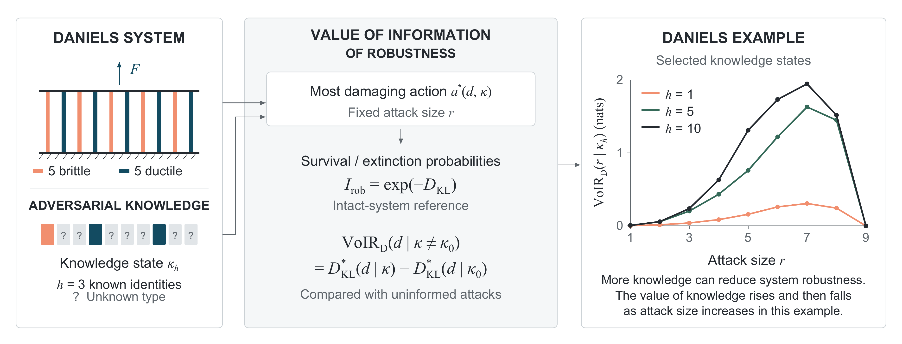
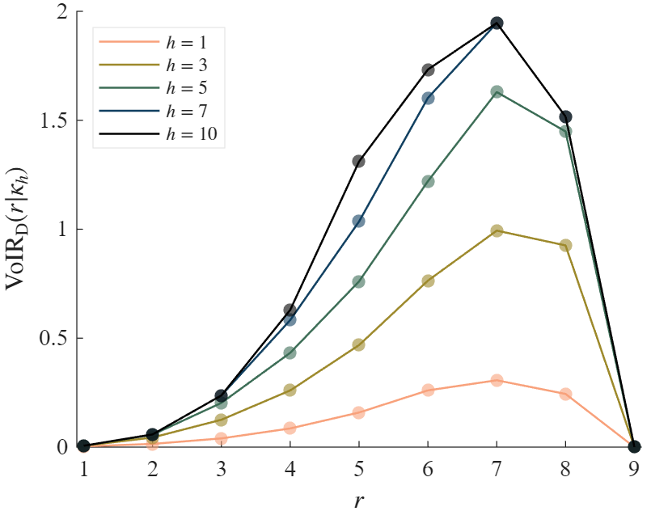

# VoIR: adversarial knowledge and system robustness

How much does an adversary's knowledge matter for the robustness of a system? VoIR connects system reliability, adversarial action selection and entropy-based robustness.

This repository is the authoritative MATLAB implementation accompanying [**Quantifying the influence of adversarial knowledge on the robustness of systems under attack**](https://doi.org/10.1016/j.strusafe.2026.102773), by Alex Sixie Cao and Leandro Iannacone, in *Structural Safety*. It contains the calculation code, data and figure pipeline for the paper and provides a foundation for further research.

The calculations have two independent layers: a parameterized Daniels system supplies physical response probabilities; the VoIR calculation uses those probabilities to evaluate adversarial knowledge, attack choices and robustness.

[](docs/figures/graphical_abstract/voir_graphical_abstract.pdf)

**Current numerical revision:** intact and attacked systems use the same prescribed loading condition, every initial damage outcome is included, and the $\pi$ limit applies only when plotting. Probabilities lost to the original cap are evaluated by deterministic integration of the same Gaussian model. The pipeline also evaluates the one- and two-component systems analytically, extending Figure 6 to attack sizes $r=1,\ldots,9$. The included figure set uses this extended calculation.

## Start here

Open MATLAB with this repository as the current folder and run:

```matlab
publication_walkthrough
```

For a step-by-step explanation, open [publication_walkthrough.m](publication_walkthrough.m) in the MATLAB Editor and run its nine `%%` sections in order. It exposes the physical definition, initiating-scenario weights, response matrix, candidate attacks, robustness and VoIR. Intermediate variables and tables remain in the workspace. Set `renderFigures = false` in the setup section to work through the calculations without exporting figures.

The walkthrough reads the 30 bundled MAT files, evaluates their missing tails and the one- and two-component systems without random sampling, and writes tables, a saved model and Figures 1 and 3-7 under `results/publication_walkthrough/`. Individual panels are included; illustrative Figure 2 is omitted.

The [figure index](docs/figures/README.md) provides the revised panels and combined figures as PDF, SVG and PNG, generated on 26 October 2026.

For a callable pipeline using the same calculations:

```matlab
[model, report] = reproduce_publication;
```

Its default output is `results/publication/`. Use `reproduce_publication('Render',false)` for numerical work only. Outputs include `aggregate_h_r.csv`, `figure_series.csv` and `results.mat`; figure exports are PDF, SVG and PNG. The case table identifies which probabilities use saved Monte Carlo estimates and which use deterministic calculation. `analytical_responses.csv` records the five additional compositions for attack sizes $r=8$ and $r=9$; `aggregate_h_r.csv` includes survival probabilities as well as extinction probabilities.

Tested with **MATLAB R2025b**, with Statistics and Machine Learning Toolbox required for the probability calculations. Figure exports use Times New Roman. Parallel simulation additionally requires Parallel Computing Toolbox.

The bundled data combine six coauthor-provided corrected simulations and 24 unaffected publication datasets. They update the paper's numerical example using the corrected initial ductile-force calculation. The online article currently contains the earlier numerical results; the corrected results are provided here pending the proofing update.

The saved simulations used **1,000,000 Monte Carlo trials per initial damage case**. For each remaining system composition, a case specifies the numbers of initially broken brittle components and yielded ductile components. The revised figures retain uncensored estimates and calculate missing tail probabilities deterministically; homogeneous brittle cases are also evaluated analytically. To generate a new simulation dataset, use `'TrialsPerStratum',1000000` with the paper's system definition. This matches the original sample size but does not guarantee precision for every rare outcome. New simulations retain raw counts and can differ because of random sampling.

[Data notes](data/README.md) explain the inputs, filenames and available simulation information. Version 1.0.0 of the publication code, datasets and figures is archived on [Zenodo](https://doi.org/10.5281/zenodo.23657006).

## Scientific ideas

### System response and adversarial knowledge

An attack changes the physical system; knowledge changes which attack the adversary chooses. For a fixed resource budget, the adversary selects the most damaging action it can identify using its available information.

The example is a Daniels system with ten parallel components: five brittle and five ductile. Brittle components lose their resistance when they fail; ductile components can continue carrying their yield force. Component failures redistribute load and can lead to system extinction. An attack removes exactly $r$ components. The knowledge state $\kappa_h$ specifies that the adversary knows the brittle/ductile identities of $h$ components: $h=0$ is uninformed and $h=10$ is fully informed. Unknown identities are treated probabilistically when selecting an attack.

### Entropy-based robustness

For a system design $d$ and an adversary action $a$, the manuscript denotes the outcome distribution over system macrostates $S_k$ by $\mathbf{p}(d,a)$. The null action $a_0$ defines the pre-attack baseline distribution. The Kullback-Leibler divergence between the baseline and post-attack distributions is

$$
D_{\mathrm{KL}}(d,a)
=D_{\mathrm{KL}}\left(\mathbf{p}(d,a_0)\Vert\mathbf{p}(d,a)\right)
=\sum_{k}^{K}p_k(d,a_0)\ln\left(\frac{p_k(d,a_0)}{p_k(d,a)}\right)
\quad\text{for }a\ne a_0.
\qquad\text{(10)}
$$

The entropy-based robustness index, developed by [Cao and Beck (2026)](https://doi.org/10.1016/j.strusafe.2026.102688), is

$$
I_{\mathrm{rob}}
=\exp\left(-D_{\mathrm{KL}}\left(\mathbf{p}(d,a_0)\Vert\mathbf{p}(d,a)\right)\right)
=\exp\left(-D_{\mathrm{KL}}(d,a)\right)
\quad\text{for }a\ne a_0
\qquad\text{(13)}
$$

A higher robustness index corresponds to a smaller information-distance between the two outcome distributions. The logarithms are natural. In the Daniels system, the macrostates are survival $S_0$ and extinction $S_1$.

### Value of information of robustness

The best adversary action under knowledge state $\kappa$ is $a^\star(d,\kappa)$, with corresponding divergence $D_{\mathrm{KL}}^\star(d\mid\kappa)$. Relative to the uninformed knowledge state $\kappa_0$, the value of information of robustness is

$$
\mathrm{VoIR}_{\mathrm{D}}(d\mid\kappa\ne\kappa_0)
=D_{\mathrm{KL}}^\star(d\mid\kappa)
-D_{\mathrm{KL}}^\star(d\mid\kappa_0)
\quad(\mathrm{nats})
\qquad\text{(19)}
$$

In the robustness space,

$$
\mathrm{VoIR}_{\mathrm{R}}(d\mid\kappa)
=\exp\left(-\mathrm{VoIR}_{\mathrm{D}}(d\mid\kappa)\right)
\qquad\text{(21)}
$$

$\mathrm{VoIR}_{\mathrm D}$ is measured in nats. It quantifies the effect of the adversary's knowledge on robustness from the defender's perspective. The manuscript also defines defender belief-weighted robustness using the defender's belief $P(\kappa)$ in the adversary's knowledge state.



**Figure 6:** Effect of attack size $r$ on the value of information of robustness $\mathrm{VoIR}_{\mathrm{D}}(r\mid\kappa_h)$ in a Daniels system with five brittle and five ductile components, for selected knowledge states corresponding to knowledge of the identity of $h$ components. The revised curves cover attack sizes $r=1,\ldots,9$: they peak at $r=7$, decrease at $r=8$ and reach zero at $r=9$. At $r=9$, the single remaining component has the same capacity distribution for both materials, so knowing its type provides no advantage.

## Use the two calculation layers separately

For another composition or loading, define the physical system and generate its conditional responses:

```matlab
system = daniels_system( ...
    'BrittleCount', 3, ...
    'DuctileCount', 2, ...
    'Load', 1000, ...
    'MeanCapacity', 400, ...
    'CapacitySD', 140);

data = simulate_daniels(system, ...
    'AttackSizes', 1:3, ...
    'TrialsPerStratum', 1000, ...
    'Seed', 1234);

analysis = calculate_voir(data);
```

This example uses **1,000 trials per initial damage case** to demonstrate usage; use a larger sample size for more precise estimates. Sampling runs serially by default. Add `'Workers',4` to `simulate_daniels` to use four process workers. `TrialsPerStratum` sets the number of trials for each initial damage case. The explicit seed and saved task order identify repeatable local random sequences.

The total component count is the sum of the brittle and ductile counts. Load is explicit and does not automatically scale with component count. The same Gaussian capacity distribution, brittle/ductile mechanics, knowledge model and robustness formulas apply to the chosen parameters. Each initially yielded ductile component retains its sampled force.

VoIR also accepts an existing response matrix and null reference independently:

```matlab
analysis = calculate_voir(response, p_ref, ...
    'BrittleCount', 3, ...
    'DuctileCount', 2, ...
    'AttackSizes', 1:3);
```

Response rows follow `AttackSizes`; column $\delta+1$ corresponds to removing $\delta$ ductile components. `p_ref` is the fixed intact reference under the same loading condition. Every supplied attack probability must be at least this reference for the implemented extinction-maximizing action rule to represent KL maximization. See [usage](docs/USAGE.md) for matrix dimensions, knowledge-state selection and saved results.

The publication walkthrough and figure layouts use the paper's five-brittle/five-ductile system. A newly simulated dataset with that definition and attack sizes $r=1,\ldots,7$ can enter the same publication pipeline through `reproduce_publication('SimulationData',data)`. The pipeline exports composition MAT files, reloads them, adds the analytical responses for attack sizes $r=8$ and $r=9$, and produces the results and figures without additional sampling. Other parameter combinations use `simulate_daniels` and `calculate_voir` directly.

See the [paper-to-code map and model conventions](docs/METHODS.md#from-the-paper-to-the-code) for the functions behind each concept and figure, conditioning, probability transformations and the initial ductile-force calculation.

## Repository layout

| Location | Purpose |
| --- | --- |
| [publication_walkthrough.m](publication_walkthrough.m) | Explain and reproduce the updated example section by section |
| [daniels_system.m](daniels_system.m), [simulate_daniels.m](simulate_daniels.m) | Define a physical system and simulate its conditional responses |
| [calculate_voir.m](calculate_voir.m) | Evaluate knowledge, actions, robustness and VoIR |
| [reproduce_publication.m](reproduce_publication.m) | Run the publication pipeline as a function |
| `src/+daniels/` | Conditional sampling, component mechanics and response mixtures |
| `src/+voir/` | Observation weights, action selection and Bernoulli divergence |
| `src/+publication/` | MAT input/output, numerical tables and figure layout |
| [data/](data/README.md) | Publication MAT inputs and the Batlow palette |
| [docs/](docs/USAGE.md) | Usage, model conventions and the complete generated figure set |
| `results/` | Generated outputs; ignored by Git |

The MATLAB functions use numbered sections to explain the physical and probabilistic meaning before the corresponding code. The walkthrough is a plain-text `.m` script so explanations and computations can also be read together on GitHub.

## References and licence

Please cite the accompanying paper and identify the software commit or release used in your research:

- Cao, A. S., and Iannacone, L. (2026). *Quantifying the influence of adversarial knowledge on the robustness of systems under attack*. Structural Safety, 102773. [doi:10.1016/j.strusafe.2026.102773](https://doi.org/10.1016/j.strusafe.2026.102773).
- Cao, A. S., and Beck, A. T. (2026). *On the quantification of robustness and its thresholds*. Structural Safety, 120, 102688. [doi:10.1016/j.strusafe.2026.102688](https://doi.org/10.1016/j.strusafe.2026.102688).

Machine-readable paper and software references are in [CITATION.cff](CITATION.cff).

The software is licensed under the [MIT licence](LICENSE). The Batlow palette is credited to Fabio Crameri's Scientific colour maps; see [third-party notices](THIRD_PARTY_NOTICES.md).
